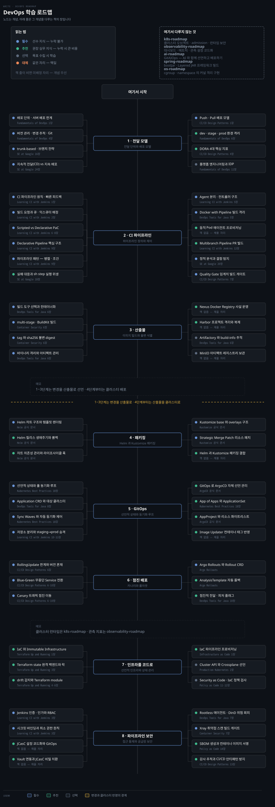
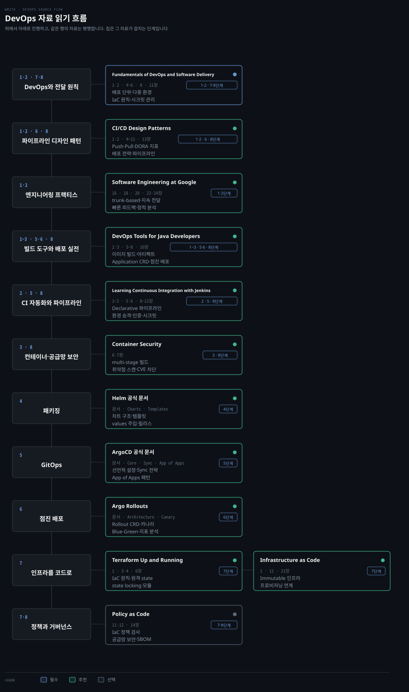

# DevOps 학습 로드맵
---

> 코드 변경에서 클러스터 반영·인프라 선언까지 이어집니다. 개념이 주인공이고 책은 그 개념을 다루는 자리입니다.

## 학습 순서

> 단계마다 배우는 개념을 묶음으로 갈랐습니다. 자료 위치는 아래 단계별 표가 짚습니다.

| 단계 | 묶음 | 배우는 개념 |
|---|---|---|
| 1 · 전달 모델 | 전달 단위와 배포 모델 | 배포 단위 · 서버 배포 vs 로컬 배포 · Push 모델 · Pull 모델(GitOps) · Continuous Delivery vs Continuous Deployment |
| 1 · 전달 모델 | 버전 관리와 협업 | 버전 관리 · 변경 추적 · Git · 브랜치 전략 · trunk-based development · 짧은 브랜치 수명 |
| 1 · 전달 모델 | 환경과 성과 측정 | 다중 환경 격리 · dev · stage · prod 환경 분리 · DORA 4대 지표 · 플랫폼 엔지니어링 |
| 2 · CI 파이프라인 | 파이프라인 정의와 제어 | CI 파이프라인 원칙 · 빌드 요청과 큐 · Scripted vs Declarative · Declarative Pipeline 핵심 구조 · Pipeline 패턴 |
| 2 · CI 파이프라인 | 실행 환경과 에이전트 | Jenkins Agent · Docker with Pipeline · Kubernetes Jenkins · 동적 Pod 에이전트 · 실패 대응과 sh 위생 |
| 2 · CI 파이프라인 | 정적 분석과 품질 게이트 | SonarQube · 정적 분석 결함 · Clean as You Code · Quality Gate · withSonarQubeEnv |
| 2 · CI 파이프라인 | 파이프라인 운영과 확장 | Multibranch Pipeline · Pipeline 내구성 · 공유 라이브러리 · 파이프라인 디자인 패턴 · Jenkins API · Jenkins 엔진 |
| 3 · 산출물 | 이미지 빌드와 최적화 | 빌드 도구 비교와 선택 · 컨테이너 이미지 빌드 · multi-stage build · BuildKit · Kaniko |
| 3 · 산출물 | 식별과 불변성 | tag 와 digest · sha256 불변 참조 · semantic versioning · 태그 변조 방지 |
| 3 · 산출물 | 저장소와 레지스트리 | 아티팩트 관리 기초 · hosted · proxy · group · Nexus · Harbor · Artifactory · MinIO |
| 4 · 패키징 | Helm 패키징 | Helm 차트 구조 · Chart.yaml · values.yaml · 템플릿 렌더링 · 릴리스 생애주기 · 훅 |
| 4 · 패키징 | Kustomize 선언 | Kustomize 오버레이 · kustomization.yaml · base 와 overlays · Strategic Merge Patch · 리소스 패치 |
| 4 · 패키징 | 패키징 전략 비교 | Helm 과 Kustomize 비교 · 템플릿 엔진 vs 패치 엔진 · 결합 패턴 |
| 5 · GitOps | GitOps 원칙과 선언 | GitOps 원칙 · SSOT · 풀 기반 동기화 루프 · ArgoCD 아키텍처 · 선언적 설정 |
| 5 · GitOps | 동기화와 배포 제어 | Application CRD · automated sync · self-heal · prune · Sync Waves · Sync Hooks |
| 5 · GitOps | 대규모 배포와 테넌시 | App of Apps · ApplicationSet · 생성기 · 멀티클러스터 · AppProject 멀티테넌시 |
| 5 · GitOps | 환경 승격과 연계 | 저장소 분리 · dev · stage · prod 환경 승격 · CI-CD 파이프라인 연계 · Image Updater |
| 6 · 점진 배포 | 롤링 한계와 블루그린 | RollingUpdate 의 한계 · 트래픽 분기 불가 · Blue-Green 배포 · Service 전환 · 무중단 배포 |
| 6 · 점진 배포 | 카나리와 롤아웃 | Canary 배포 · 점진 트래픽 이동 · Argo Rollouts · Rollout CRD · 트래픽 가중치 라우팅 |
| 6 · 점진 배포 | 지표 분석과 전달 패턴 | AnalysisTemplate · 지표 기반 자동 분석과 롤백 · Progressive Delivery · 피처 플래그 · Dark Launch |
| 7 · 인프라를 코드로 | 선언적 인프라 원칙 | IaC 와 Immutable Infrastructure · 고치지 않고 다시 만든다 · 파이프라인 프로비저닝 연계 |
| 7 · 인프라를 코드로 | Terraform 핵심 운영 | Terraform state · 원격 백엔드 · state locking · drift 감지 · module · 비밀 관리 |
| 7 · 인프라를 코드로 | 오브젝트 선언과 정책 | 클러스터를 오브젝트로 선언 · Cluster API · Crossplane · IaC 정책 검사 · Security as Code |
| 8 · 파이프라인 보안 | 접근 통제와 시크릿 | Jenkins 인증과 인가 · RBAC · Credentials 바인딩과 마스킹 · 최소 권한 원칙 |
| 8 · 파이프라인 보안 | 설정의 코드화 | 설정을 코드로 JCasC · jenkins.yaml 버전 관리 · JCasC 운영과 GitOps · JCasC 시크릿과 Vault 연동 |
| 8 · 파이프라인 보안 | 빌드 격리와 공급망 | Rootless 컨테이너 에이전트 · DinD 위험 회피 · 취약점 스캔 게이트(Xray) · SBOM · 이미지 서명 |
| 8 · 파이프라인 보안 | 감사와 안티패턴 방지 | 규제 산업 준수 파이프라인 · 감사 추적 · Shift-Left 보안 감사 · CI/CD 안티패턴 방지 |

## 자료 읽기 흐름

> 위 단계를 무엇으로 배우는가입니다. 책과 문서를 한 표에 두고, 자료마다 어느 단계에 쓰이는지와 읽을 범위를 적습니다.

《Fundamentals of DevOps and Software Delivery》 로 파이프라인 원칙을 세웁니다. Jenkins 와 ArgoCD 관련 서적과 공식 문서로 도구 구현을 채우고, 인프라 선언과 보안은 Terraform 과 컨테이너 보안서로 보완합니다.

| 자료 | 종류 | 읽을 범위 | 우선순위 | 자리 |
|---|:---:|---|:---:|---|
| [Fundamentals of DevOps and Software Delivery](../07_devops/book/fdsd_fundamentals-devops/README.md) | 책 | 1·2 · 4~6 · 8 · 11장 | 필수 | 1·2 · 7·8단계 |
| [CI/CD Design Patterns](../07_devops/book/cicd_cicd-patterns/README.md) | 책 | 1·2 · 4~11 · 13장 | 추천 | 1·2 · 6 · 8단계 |
| Learning Continuous Integration with Jenkins | 책 | 1~3 · 5·6 · 8~12장 | 추천 | 2 · 5 · 8단계 |
| DevOps Tools for Java Developers | 책 | 2·3 · 5~8 · 10장 | 추천 | 1~3 · 5·6 · 8단계 |
| Software Engineering at Google | 책 | 16 · 18 · 20 · 23·24장 | 추천 | 1·2단계 |
| [Container Security](../08_cloud/book/container-security/README.md) | 책 | 6·7장 | 추천 | 3 · 8단계 |
| Terraform Up and Running | 책 | 1 · 3·4 · 6장 | 추천 | 7단계 |
| Infrastructure as Code | 책 | 1 · 11 · 21장 | 추천 | 7단계 |
| Policy as Code | 책 | 11·12 · 14장 | 선택 | 7·8단계 |
| [ArgoCD 공식 문서](https://argo-cd.readthedocs.io/) | 문서 | Core 개념 · Sync 전략 · App of Apps · ApplicationSet | 추천 | 5단계 |
| [Argo Rollouts](https://argo-rollouts.readthedocs.io/) | 문서 | Architecture · Canary · Blue-Green · Analysis | 추천 | 6단계 |
| [Helm 공식 문서](https://helm.sh/docs/) | 문서 | Charts · Templates · Values | 추천 | 4단계 |

**보완 참조** — 단계 표의 노트나 책 칸이 가리키지만 읽기 흐름에는 넣지 않은 장입니다. 그 개념에 닿았을 때만 엽니다.

| 책 | 장 | 받치는 자리 |
|---|---|---|
| Kubernetes Best Practices | 18장 | 5단계 GitOps · ArgoCD · App of Apps |
| Production Kubernetes | 2장 | 7단계 클러스터를 오브젝트로 선언 — Cluster API · Crossplane |
| Learning Continuous Integration with Jenkins | 4·7장 | 2단계 Jenkins 확장 및 AI 기반 파이프라인 작성 |
| Infrastructure as Code | 14~16장 | 7단계 파이프라인 기반 인프라 배포 워크플로우 |
| Policy as Code | 1~3장 | 8단계 정책 코드화 기초 및 접근 제어 |

## 변경을 산출물로 · 1~3단계

> 코드 변경에서 시작해 검증과 빌드를 거쳐 신뢰할 수 있는 불변 산출물을 만드는 구간입니다.

### 1단계 · 전달 모델

| 개념 | 우선순위 | 노트 | 책 |
|---|:---:|---|---|
| 배포 단위 · 서버 배포와 로컬의 한계 | 필수 | [앱 배포 방법](../07_devops/book/fdsd_fundamentals-devops/01-01.How%20to%20Deploy%20Your%20App.md) | Fundamentals of DevOps and Software Delivery 1장 |
| 버전 관리 · 변경 추적 · Git | 필수 | [코드 버전 관리와 빌드](../07_devops/book/fdsd_fundamentals-devops/04-01.How%20to%20Version%20Build%20and%20Test%20Your%20Code.md) | Fundamentals of DevOps and Software Delivery 4장 · DevOps Tools for Java Developers 2장 |
| 브랜치 전략 · trunk-based development · 짧은 브랜치 수명 | 필수 | [CD와 GitOps](../07_devops/02_Jenkins/06_infra/05-03.CD%EC%99%80%20GitOps%20%E2%80%94%20%EA%B0%9C%EB%85%90%C2%B7%EB%B8%8C%EB%9E%9C%EC%B9%98%20%EC%A0%84%EB%9E%B5.md) | Software Engineering at Google 16장 |
| 지속적 전달(CD) vs 지속적 배포 · 빌드 사이클 5단계 | 필수 | [CI/CD 기초 패턴](../07_devops/book/cicd_cicd-patterns/01-01.Foundations%20of%20CICD%20Design%20Patterns.md) | Software Engineering at Google 24장 |
| 배포 모델 — Push 모델 vs Pull 모델(GitOps) | 필수 | [CI/CD 기초 패턴](../07_devops/book/cicd_cicd-patterns/01-01.Foundations%20of%20CICD%20Design%20Patterns.md) | CI/CD Design Patterns 1장 |
| 배포 환경 분리 — dev · stage · prod 다중 환경 격리 | 추천 | [다중 환경과 분할](../07_devops/book/fdsd_fundamentals-devops/06-01.How%20to%20Work%20with%20Multiple%20Teams%20and%20Environments.md) | Fundamentals of DevOps and Software Delivery 6장 |
| DORA 4대 지표 — 배포 빈도 · 리드 타임 · 변경 실패율 · MTTR | 추천 | [DORA와 비즈니스 정렬](../07_devops/book/cicd_cicd-patterns/04-01.Business%20Outcome%20Alignment%20with%20CICD.md) | CI/CD Design Patterns 4장 |
| 추상화의 진화 — 플랫폼 엔지니어링과 IDP | 선택 | [DevOps의 미래](../07_devops/book/fdsd_fundamentals-devops/11-01.The%20Future%20of%20DevOps%20and%20Software%20Delivery.md) | Fundamentals of DevOps and Software Delivery 11장 |

### 2단계 · CI 파이프라인

> 먼저: 이 문서 1단계 버전 관리 · 브랜치 전략 · trunk-based

| 개념 | 우선순위 | 노트 | 책 |
|---|:---:|---|---|
| CI 파이프라인 원칙 · 빠른 피드백 루프 | 필수 | [Jenkins 제어 범위](../07_devops/02_Jenkins/01_core/01-01.Jenkins%EA%B0%80%20%EC%A0%9C%EC%96%B4%ED%95%98%EB%8A%94%20%EA%B2%83.md) · [CI/CD 설정](../07_devops/book/fdsd_fundamentals-devops/05-01.How%20to%20Set%20Up%20CI%20CD.md) | Learning Continuous Integration with Jenkins 1장 · Software Engineering at Google 23장 |
| 빌드 요청에서 실행까지 — 트리거 · 큐 · 익스큐터 배정 | 필수 | [빌드 요청에서 실행까지](../07_devops/02_Jenkins/01_core/01-02.%EB%B9%8C%EB%93%9C%20%EC%9A%94%EC%B2%AD%EC%97%90%EC%84%9C%20%EC%8B%A4%ED%96%89%EA%B9%8C%EC%A7%80.md) | Learning Continuous Integration with Jenkins 2장 |
| 코드로 파이프라인 정의하기 — Scripted vs Declarative | 필수 | [파이프라인 정의](../07_devops/02_Jenkins/01_core/02-01.%EC%BD%94%EB%93%9C%EB%A1%9C%20%ED%8C%8C%EC%9D%B4%ED%94%84%EB%9D%BC%EC%9D%B8%20%EC%A0%95%EC%9D%98%ED%95%98%EA%B8%B0.md) · [PaC 유형](../07_devops/book/cicd_cicd-patterns/02-01.Types%20of%20CICD%20Design%20Patterns%20and%20Components.md) | Learning Continuous Integration with Jenkins 6·8장 |
| Declarative Pipeline 핵심 구조 — pipeline · agent · stages · steps · post | 필수 | [Declarative Pipeline 핵심 구조](../07_devops/02_Jenkins/01_core/02-02.Declarative%20Pipeline%20%ED%95%B5%EC%8B%AC%20%EA%B5%AC%EC%A1%B0.md) | Learning Continuous Integration with Jenkins 9장 |
| 파이프라인 패턴 — 병렬 실행 · 조건부 실행(when) · 환경변수 | 필수 | [Pipeline 패턴](../07_devops/02_Jenkins/01_core/02-03.Pipeline%20%ED%8C%A8%ED%84%B4.md) · [구조 패턴](../07_devops/book/cicd_cicd-patterns/05-01.Exploring%20Structural%20CICD%20Design%20Patterns.md) | Learning Continuous Integration with Jenkins 9장 |
| 실패 대응과 셸 실행 위생 — retry · timeout · sh step 위생 | 추천 | [실패 대응과 파이프라인 원칙](../07_devops/02_Jenkins/01_core/02-04.%EC%8B%A4%ED%8C%A8%20%EB%8C%80%EC%9D%91%EA%B3%BC%20%ED%8C%8C%EC%9D%B4%ED%94%84%EB%9D%BC%EC%9D%B8%20%EC%9B%90%EC%B9%99.md) · [sh step 실행 위생](../07_devops/02_Jenkins/01_core/02-05.sh%20step%20%EC%85%B8%20%EC%8B%A4%ED%96%89%20%EC%9C%84%EC%83%9D.md) | Software Engineering at Google 18장 |
| 실행환경으로서의 Agent — 컨트롤러와 에이전트 분리 | 필수 | [실행환경 Agent](../07_devops/02_Jenkins/03_agent/01-01.%EC%8B%A4%ED%96%89%ED%99%98%EA%B2%BD%EC%9C%BC%EB%A1%9C%EC%84%9C%EC%9D%98%20Agent.md) | Learning Continuous Integration with Jenkins 5장 |
| Docker with Pipeline — 컨테이너 기반 빌드 격리 | 필수 | [Docker with Pipeline](../07_devops/02_Jenkins/03_agent/01-02.Docker%20with%20Pipeline.md) | DevOps Tools for Java Developers 5장 |
| Kubernetes Jenkins — 동적 Pod 에이전트 프로비저닝 | 추천 | [K8s Jenkins 구축](../07_devops/02_Jenkins/03_agent/02-01.Kubernetes%20Jenkins%20%EA%B5%AC%EC%B6%95.md) · [K8s Jenkins 운영](../07_devops/02_Jenkins/03_agent/02-02.Kubernetes%20Jenkins%20%EC%9A%B4%EC%98%81.md) |  |
| Pipeline 내구성과 재기동 — CpsFlowExecution 영속화 | 추천 | [Pipeline 내구성과 재기동](../07_devops/02_Jenkins/05_operations/01-01.Pipeline%20%EB%82%B4%EA%B5%AC%EC%84%B1%EA%B3%BC%20%EC%9E%AC%EA%B8%B0%EB%8F%99.md) | Learning Continuous Integration with Jenkins 2장 |
| 공유 라이브러리(Shared Library) — vars 와 src 로 파이프라인 재사용 | 추천 | [공유 라이브러리](../07_devops/02_Jenkins/05_operations/02-01.%EA%B3%B5%EC%9C%A0%20%EB%9D%BC%EC%9D%B4%EB%B8%8C%EB%9F%AC%EB%A6%AC.md) · [공유 라이브러리 실전](../07_devops/02_Jenkins/05_operations/02-01a.%EA%B3%B5%EC%9C%A0%20%EB%9D%BC%EC%9D%B4%EB%B8%8C%EB%9F%AC%EB%A6%AC%20%EC%8B%A4%EC%A0%84%20%ED%8C%A8%ED%84%B4.md) | Learning Continuous Integration with Jenkins 12장 |
| Multibranch Pipeline — branch-source 기반 PR 자동 빌드 | 추천 | [CI 파이프라인 전체 설계](../07_devops/02_Jenkins/06_infra/05-01.CI%20%ED%8C%8C%EC%9D%B4%ED%94%84%EB%9D%BC%EC%9D%B8%20%EC%A0%84%EC%B2%B4%20%EC%84%A4%EA%B3%84%20%E2%80%94%20%EC%8A%A4%ED%85%8C%EC%9D%B4%EC%A7%80%20%EC%88%9C%EC%84%9C%C2%B7Docker%20%EB%A0%88%EC%A7%80%EC%8A%A4%ED%8A%B8%EB%A6%AC%C2%B7%EC%9D%B8%EC%A6%9D.md) · [첫 CI Jenkinsfile 구현](../07_devops/02_Jenkins/06_infra/05-02.%EC%B2%AB%20CI%20Jenkinsfile%20%EA%B5%AC%ED%98%84%20%E2%80%94%20%EC%99%84%EC%84%B1%20%EC%BD%94%EB%93%9C%C2%B7Multibranch%C2%B7Blue%20Ocean.md) | Learning Continuous Integration with Jenkins 12장 |
| 정적 분석과 결함 탐지 — 버그 · 취약점 · 코드 스멜 | 필수 | [정적 분석이 푸는 결함](../07_devops/docs/sonarqube/01-01.%EC%A0%95%EC%A0%81%20%EB%B6%84%EC%84%9D%EC%9D%B4%20%ED%91%B8%EB%8A%94%20%EA%B2%B0%ED%95%A8.md) | Software Engineering at Google 20장 |
| Clean as You Code — 신규 코드 중심 품질 관리 | 추천 | [Clean as You Code](../07_devops/docs/sonarqube/01-03.Clean%20as%20You%20Code%EC%99%80%20MQR.md) |  |
| SonarQube Quality Gate — 임계치 판정과 빌드 게이트 | 필수 | [Quality Gate](../07_devops/docs/sonarqube/02-04.Quality%20Gate.md) · [Jenkins 연계](../07_devops/docs/sonarqube/04-01.Jenkins%20%EC%97%B0%EA%B3%84.md) | CI/CD Design Patterns 7장 |
| 클러스터 안 CI 도구 — Jenkins · SonarQube · Harbor | 선택 | [Jenkins on K8s](../08_cloud/kubernetes/11_devtools/11-01.Jenkins%20on%20K8s.md) · [Harbor](../08_cloud/kubernetes/11_devtools/11-04.Harbor.md) |  |
| 파이프라인 행위·생성 디자인 패턴 — Observer · Strategy · Builder | 선택 | [행위 디자인 패턴](../07_devops/book/cicd_cicd-patterns/07-01.Understanding%20Behavioral%20Design%20Patterns%20for%20CICD.md) · [생성 디자인 패턴](../07_devops/book/cicd_cicd-patterns/09-01.Applying%20Creational%20CICD%20Design%20Patterns.md) | CI/CD Design Patterns 7·9장 |
| Jenkins REST API — 빌드 트리거 · 큐 및 실행기 원격 제어 | 선택 | [Jenkins API](../07_devops/02_Jenkins/04_api/README.md) |  |
| Jenkins 내부 엔진 — Stapler 라우팅 · Queue 스케줄링 | 선택 | [Jenkins 엔진](../07_devops/02_Jenkins/07_engine/README.md) |  |

### 3단계 · 산출물

> 먼저: 이 문서 2단계 Declarative Pipeline · Docker with Pipeline · [OS 로드맵](os-roadmap.md) 3단계 namespace · cgroup v2

| 개념 | 우선순위 | 노트 | 책 |
|---|:---:|---|---|
| 빌드 도구 선택과 컨테이너화 — Gradle · Maven · npm | 필수 | [빌드 도구 비교와 선택](../07_devops/02_Jenkins/03_agent/01-03.%EB%B9%8C%EB%93%9C%20%EB%8F%84%EA%B5%AC%20%EB%B9%84%EA%B5%90%EC%99%80%20%EC%84%A0%ED%83%9D.md) | DevOps Tools for Java Developers 6장 |
| 컨테이너 이미지 빌드 — multi-stage · BuildKit · Kaniko | 필수 | [컨테이너 이미지 빌드](../07_devops/02_Jenkins/03_agent/01-04.%EC%BB%A8%ED%85%8C%EC%9D%B4%EB%84%88%20%EC%9D%B4%EB%AF%B8%EC%A7%80%20%EB%B9%8C%EB%93%9C.md) | Container Security 6장 · DevOps Tools for Java Developers 3장 |
| tag 와 digest — 태그 가변성 한계와 sha256 불변 참조 | 필수 | [컨테이너 이미지 빌드](../07_devops/02_Jenkins/03_agent/01-04.%EC%BB%A8%ED%85%8C%EC%9D%B4%EB%84%88%20%EC%9D%B4%EB%AF%B8%EC%A7%80%20%EB%B9%8C%EB%93%9C.md) | Container Security 6장 |
| 아티팩트 관리 기초 — 바이너리 격리 · hosted · proxy · group | 필수 | [아티팩트 관리 기초](../07_devops/03_Nexus/01-01.%EC%95%84%ED%8B%B0%ED%8C%A9%ED%8A%B8%20%EA%B4%80%EB%A6%AC%EC%9D%98%20%EA%B8%B0%EC%B4%88.md) · [리포지토리 포맷](../07_devops/03_Nexus/02-01.%EB%A6%AC%ED%8F%AC%EC%A7%80%ED%86%A0%EB%A6%AC%20%ED%8F%AC%EB%A7%B7%EA%B3%BC%20%EA%B5%AC%EC%84%B1.md) | DevOps Tools for Java Developers 6장 |
| 사설 Docker 레지스트리 운영 — Nexus Docker Registry | 추천 | [Docker Registry Nexus](../07_devops/03_Nexus/04-02.Docker%20Registry%EB%A1%9C%EC%84%9C%EC%9D%98%20Nexus.md) |  |
| 클라우드 네이티브 레지스트리 — Harbor 프로젝트 격리와 복제 | 추천 | [Harbor](../08_cloud/kubernetes/11_devtools/11-04.Harbor.md) |  |
| 엔터프라이즈 산출물 관리 — Artifactory 와 build-info 추적 | 선택 | [Artifactory 연동](../07_devops/02_Jenkins/06_infra/02-03.Artifactory%20%EC%97%B0%EB%8F%99%20%E2%80%94%20%EC%95%84%ED%8B%B0%ED%8C%A9%ED%8A%B8%20%EC%A0%80%EC%9E%A5%EC%86%8C.md) | DevOps Tools for Java Developers 6장 |
| 객체 스토리지 산출물 보관 — MinIO 아티팩트 레지스트리 | 선택 | [MinIO 아티팩트 레지스트리](../07_devops/02_Jenkins/06_infra/06-03.MinIO%20%EC%95%84%ED%8B%B0%ED%8C%A9%ED%8A%B8%20%EB%A0%88%EC%A7%80%EC%8A%A4%ED%8A%B8%EB%A6%AC%20%E2%80%94%20mc%20CLI%C2%B7%EB%B2%84%EC%A0%84%20%ED%95%80%C2%B7%EB%B9%8C%EB%93%9C%20%EC%82%B0%EC%B6%9C%EB%AC%BC%20%EC%97%B0%EA%B3%84.md) |  |

## 산출물을 클러스터로 · 4~6단계

> 만들어진 패키지와 이미지를 GitOps 엔진으로 클러스터에 배포하고 점진적으로 트래픽을 여는 구간입니다.

### 4단계 · 패키징

> 먼저: 이 문서 3단계 아티팩트 레지스트리 · tag 와 digest · [Kubernetes 로드맵](k8s-roadmap.md) 1단계 매니페스트

| 개념 | 우선순위 | 노트 | 책 |
|---|:---:|---|---|
| Helm 차트 구조 · Chart.yaml · values.yaml · 템플릿 렌더링 | 필수 | [Helm 기초](../08_cloud/kubernetes/10_packaging/10-01.Helm%20%EA%B8%B0%EC%B4%88.md) | [Helm 공식 문서](https://helm.sh/docs/) |
| Helm 릴리스 생애주기 · 롤백 · 의존성 관리 · 라이프사이클 훅 | 추천 | [Helm 고급](../08_cloud/kubernetes/10_packaging/10-02.Helm%20%EA%B3%A0%EA%B8%89.md) | [Helm 공식 문서](https://helm.sh/docs/) |
| Kustomize 오버레이 · base 와 overlays · 리소스 패치 | 필수 | [Kustomize](../08_cloud/kubernetes/10_packaging/10-03.Kustomize.md) | [Kustomize 공식 문서](https://kubectl.docs.kubernetes.io/) |
| Helm · Kustomize | 추천 | [Helm 기초](../08_cloud/kubernetes/10_packaging/10-01.Helm%20%EA%B8%B0%EC%B4%88.md) ~ [Kustomize](../08_cloud/kubernetes/10_packaging/10-03.Kustomize.md) |  |

### 5단계 · GitOps

> 먼저: 이 문서 1단계 trunk-based · 4단계 Helm · Kustomize · [Kubernetes 로드맵](k8s-roadmap.md) 2단계 Deployment

| 개념 | 우선순위 | 노트 | 책 |
|---|:---:|---|---|
| GitOps 원칙과 아키텍처 — 선언적 상태 · 풀 기반 동기화 루프 | 필수 | [ArgoCD와 GitOps 기초](../08_cloud/argocd/01-01.ArgoCD%EC%99%80%20GitOps%20%EA%B8%B0%EC%B4%88.md) · [ArgoCD 설치와 아키텍처](../08_cloud/argocd/01-02.ArgoCD%20%EC%84%A4%EC%B9%98%EC%99%80%20%EC%95%84%ED%82%A4%ED%85%8D%EC%B2%98.md) | Kubernetes Best Practices 18장 |
| ArgoCD 접근과 선언적 설정 — GitOps 로 ArgoCD 자체 관리 | 추천 | [선언적 설정](../08_cloud/argocd/01-03.ArgoCD%20%EC%A0%91%EA%B7%BC%EA%B3%BC%20%EC%84%A0%EC%96%B8%EC%A0%81%20%EC%84%A4%EC%A0%95.md) | [ArgoCD 공식 문서](https://argo-cd.readthedocs.io/) |
| Application CRD — 배포 소스(Git)와 목적지(Cluster) 관리 | 필수 | [Application 관리](../08_cloud/argocd/02-01.Application%EA%B3%BC%20%EB%B0%B0%ED%8F%AC%20%EB%8C%80%EC%83%81%20%EA%B4%80%EB%A6%AC.md) | DevOps Tools for Java Developers 8장 |
| Sync 전략과 순서 제어 — automated sync · self-heal · prune · Sync Waves | 필수 | [Sync 전략](../08_cloud/argocd/02-02.Sync%20%EC%A0%84%EB%9E%B5%EA%B3%BC%20%EB%B0%B0%ED%8F%AC%20%EC%88%9C%EC%84%9C%20%EC%A0%9C%EC%96%B4.md) | Kubernetes Best Practices 18장 |
| GitOps · ArgoCD · App of Apps · ApplicationSet | 추천 | [ArgoCD와 GitOps](../08_cloud/kubernetes/11_devtools/11-03.ArgoCD%EC%99%80%20GitOps.md) · [ArgoCD 노트](../08_cloud/argocd/README.md) | Kubernetes Best Practices 18장 |
| 대규모 배포 패턴 — App of Apps 패턴 · ApplicationSet 생성기 | 추천 | [App of Apps와 ApplicationSet](../08_cloud/argocd/02-03.App%20of%20Apps%EC%99%80%20ApplicationSet.md) · [App of Apps와 멀티테넌시](../07_devops/book/aic_ai-infra-claude/07-02.App%20of%20Apps%EC%99%80%20%EB%A9%80%ED%8B%B0%ED%85%8C%EB%84%8C%EC%8B%9C.md) | Kubernetes Best Practices 18장 |
| 멀티테넌시와 권한 격리 — AppProject · 리소스 화이트리스트 | 추천 | [인증·인가와 AppProject](../08_cloud/argocd/03-01.%EC%9D%B8%EC%A6%9D%C2%B7%EC%9D%B8%EA%B0%80%EC%99%80%20AppProject.md) · [멀티클러스터와 멀티테넌시](../08_cloud/argocd/03-02.%EB%A9%80%ED%8B%B0%ED%81%B4%EB%9F%AC%EC%8A%A4%ED%84%B0%EC%99%80%20%EB%A9%80%ED%8B%B0%ED%85%8C%EB%84%8C%EC%8B%9C.md) | [ArgoCD 공식 문서](https://argo-cd.readthedocs.io/) |
| 환경 승격 파이프라인 — 저장소 분리 · staging→prod 승격 | 필수 | [CD와 GitOps](../07_devops/02_Jenkins/06_infra/05-03.CD%EC%99%80%20GitOps%20%E2%80%94%20%EA%B0%9C%EB%85%90%C2%B7%EB%B8%8C%EB%9E%9C%EC%B9%98%20%EC%A0%84%EB%9E%B5.md) · [Argo CD로 CD 설계](../07_devops/02_Jenkins/06_infra/05-04.Argo%20CD%EB%A1%9C%20CD%20%EC%84%A4%EA%B3%84%20%E2%80%94%20Jenkins%20%EC%97%AD%ED%95%A0%EB%B6%84%EB%8B%B4%C2%B7staging%E2%86%92prod.md) | Learning Continuous Integration with Jenkins 10·11장 |
| CI-CD 파이프라인 통합 — values 갱신 · ArgoCD 헬스체크 게이트 | 추천 | [첫 CD Jenkinsfile 구현](../07_devops/02_Jenkins/06_infra/05-05.%EC%B2%AB%20CD%20Jenkinsfile%20%EA%B5%AC%ED%98%84%20%E2%80%94%20values%20%EA%B0%B1%EC%8B%A0%C2%B7Argo%20CD%20%ED%97%AC%EC%8A%A4%EC%B2%B4%ED%81%AC%C2%B7k6%20%EA%B2%8C%EC%9D%B4%ED%8A%B8.md) · [푸시 배포의 한계와 ArgoCD](../07_devops/book/aic_ai-infra-claude/03-01.%ED%91%B8%EC%8B%9C%20%EB%B0%B0%ED%8F%AC%EC%9D%98%20%ED%95%9C%EA%B3%84%EC%99%80%20ArgoCD%20GitOps%20%E2%80%94%20%EC%84%A4%EC%B9%98%C2%B7%EC%97%B0%EA%B2%B0%C2%B7%EB%A1%A4%EB%A7%81%C2%B7%EB%A1%A4%EB%B0%B1.md) | Learning Continuous Integration with Jenkins 11장 |
| Image Updater — 컨테이너 레지스트리 새 이미지 감지와 Git 자동 커밋 | 추천 | [CI 연동과 Image Updater](../08_cloud/argocd/04-02.CI%20%EC%97%B0%EB%8F%99%EA%B3%BC%20Image%20Updater.md) |  |

### 6단계 · 점진 배포

> 먼저: 이 문서 5단계 ArgoCD · Application · [Kubernetes 로드맵](k8s-roadmap.md) 2단계 RollingUpdate · Recreate · 3단계 Service

| 개념 | 우선순위 | 노트 | 책 |
|---|:---:|---|---|
| RollingUpdate 의 한계 — 트래픽 분기 불가와 버전 혼재 | 필수 | [Rolling Update의 한계](../07_devops/book/aic_ai-infra-claude/05-01.Rolling%20Update%EC%9D%98%20%ED%95%9C%EA%B3%84%EC%99%80%20Gateway%20API.md) | CI/CD Design Patterns 6장 |
| Blue-Green 배포 — Service / Gateway API 스위칭과 무중단 전환 | 필수 | [Blue-Green 무중단 전환](../07_devops/book/aic_ai-infra-claude/05-02.Blue-Green%20%EB%AC%B4%EC%A4%91%EB%8B%A8%20%EC%A0%84%ED%99%98%EA%B3%BC%20%EC%95%84%ED%82%A4%ED%85%8D%EC%B2%98%20%EA%B2%B0%EC%A0%95%20%EA%B8%B0%EB%A1%9D.md) | CI/CD Design Patterns 6·10장 · DevOps Tools for Java Developers 10장 |
| Canary 배포 — 소량 트래픽 점진 이동과 위험 최소화 | 필수 | [점진적 배포 Canary](../07_devops/book/aic_ai-infra-claude/06-02.%EC%A0%90%EC%A7%84%EC%A0%81%20%EB%B0%B0%ED%8F%AC%20Canary%EC%99%80%20claude-context.md) | CI/CD Design Patterns 6·10장 |
| 점진 배포 — canary · blue-green · Argo Rollouts · progressive delivery | 추천 |  | [Argo Rollouts](https://argo-rollouts.readthedocs.io/) |
| Argo Rollouts — Rollout CRD 와 트래픽 라우팅 연동 | 필수 | [Argo Rollouts와 배포 전략](../08_cloud/argocd/04-03.Argo%20Rollouts%EC%99%80%20%EB%B0%B0%ED%8F%AC%20%EC%A0%84%EB%9E%B5.md) | [Argo Rollouts](https://argo-rollouts.readthedocs.io/) |
| AnalysisTemplate — 관측 지표 기반 자동 분석과 실패 시 자동 롤백 | 추천 | [Argo Rollouts와 배포 전략](../08_cloud/argocd/04-03.Argo%20Rollouts%EC%99%80%20%EB%B0%B0%ED%8F%AC%20%EC%A0%84%EB%9E%B5.md) | [Argo Rollouts](https://argo-rollouts.readthedocs.io/) |
| Progressive Delivery — 피처 플래그 · Dark Launch · 비즈니스 분리 | 추천 | [배포 전략 패턴](../07_devops/book/cicd_cicd-patterns/06-01.Deployment%20Strategies%20for%20Structural%20Patterns.md) | DevOps Tools for Java Developers 10장 |

## 인프라와 신뢰 · 7~8단계

> 파이프라인이 도는 인프라를 코드로 선언하고, 공급망과 파이프라인 자체의 보안을 굳히는 구간입니다.

### 7단계 · 인프라를 코드로

> 먼저: 이 문서 1단계 버전 관리 · [Kubernetes 로드맵](k8s-roadmap.md) 5단계 Control Plane

| 개념 | 우선순위 | 노트 | 책 |
|---|:---:|---|---|
| IaC 와 Immutable Infrastructure — 고치지 않고 다시 만든다 | 추천 | [IaC 관리](../07_devops/book/fdsd_fundamentals-devops/02-01.How%20to%20Manage%20Your%20Infrastructure%20as%20Code.md) | Terraform Up and Running 1장 · Infrastructure as Code 11장 |
| Terraform state · module · 비밀 관리 | 추천 |  | Terraform Up and Running 3·4·6장 |
| IaC로 배포 파이프라인 프로비저닝 — Terraform · Helm · JCasC 연계 | 추천 | [IaC로 Jenkins 배포](../07_devops/02_Jenkins/06_infra/01-03.IaC%EB%A1%9C%20Jenkins%20%EB%B0%B0%ED%8F%AC%20%E2%80%94%20Terraform%C2%B7JCasC%C2%B7Helm.md) | Infrastructure as Code 1장 |
| 클러스터를 오브젝트로 선언 — Cluster API · Crossplane | 선택 |  | Production Kubernetes 2장 · [Cluster API](https://cluster-api.sigs.k8s.io/) |
| IaC 정책 검사 — Security as Code | 선택 |  | Policy as Code 11·12장 · Infrastructure as Code 21장 |

### 8단계 · 파이프라인 보안

> 먼저: 이 문서 2단계 Declarative Pipeline · 3단계 컨테이너 이미지 빌드 · 7단계 비밀 관리

| 개념 | 우선순위 | 노트 | 책 |
|---|:---:|---|---|
| Jenkins 인증과 인가 — Security Realm · Matrix / Role-Based 인가 | 필수 | [인증과 인가](../07_devops/02_Jenkins/02_security/01-01.%EC%9D%B8%EC%A6%9D%EA%B3%BC%20%EC%9D%B8%EA%B0%80%20%E2%80%94%20%EB%88%84%EA%B0%80%20%EB%AC%B4%EC%97%87%EC%9D%84%20%ED%95%A0%20%EC%88%98%20%EC%9E%88%EB%8A%94%EA%B0%80.md) | Learning Continuous Integration with Jenkins 3장 |
| 시크릿 관리와 최소 권한 원칙 — Credentials 바인딩과 마스킹 | 필수 | [시크릿 관리와 최소 권한](../07_devops/02_Jenkins/02_security/01-02.%EC%8B%9C%ED%81%AC%EB%A6%BF%20%EA%B4%80%EB%A6%AC%EC%99%80%20%EC%B5%9C%EC%86%8C%20%EA%B6%8C%ED%95%9C%20%EC%9B%90%EC%B9%99.md) | Learning Continuous Integration with Jenkins 3장 · Fundamentals of DevOps and Software Delivery 8장 |
| 설정을 코드로 — JCasC(Jenkins Configuration as Code) | 추천 | [설정을 코드로 JCasC](../07_devops/02_Jenkins/02_security/02-01.%EC%84%A4%EC%A0%95%EC%9D%84%20%EC%BD%94%EB%93%9C%EB%A1%9C%20%E2%80%94%20JCasC.md) |  |
| JCasC 운영과 GitOps — jenkins.yaml 버전 관리와 자동 반영 | 추천 | [JCasC 운영과 GitOps](../07_devops/02_Jenkins/02_security/02-02.JCasC%20%EC%9A%B4%EC%98%81%EA%B3%BC%20GitOps.md) |  |
| JCasC 시크릿과 실전 패턴 — 환경변수 치환과 Vault 연동 | 추천 | [JCasC 시크릿과 실전](../07_devops/02_Jenkins/02_security/02-03.JCasC%20%EC%8B%9C%ED%81%AC%EB%A6%BF%EA%B3%BC%20%EC%8B%A4%EC%A0%84%20%ED%8C%A8%ED%84%B4.md) |  |
| 빌드 환경 격리와 권한 최소화 — Rootless 에이전트와 DinD 위험 회피 | 추천 | [VM Jenkins Docker 보안](../07_devops/02_Jenkins/03_agent/01-05.VM%20Jenkins%EC%97%90%EC%84%9C%EC%9D%98%20Docker%20%EB%B3%B4%EC%95%88%20%EB%AA%A8%EB%8D%B8.md) | DevOps Tools for Java Developers 7장 |
| 취약점 스캔 게이트 — JFrog Xray 의존성·이미지 CVE 차단 | 필수 | [Xray 보안 게이트](../07_devops/02_Jenkins/06_infra/05-06.JFrog%20Xray%EB%A1%9C%20CI%20%EB%B3%B4%EC%95%88%20%EA%B2%8C%EC%9D%B4%ED%8A%B8%20%E2%80%94%20%EC%B7%A8%EC%95%BD%EC%A0%90%20%EC%8A%A4%EC%BA%94%C2%B7xrayScan%C2%B7SonarQube%EC%99%80%20%EC%97%AD%ED%95%A0%20%EA%B5%AC%EB%B6%84.md) | Container Security 7장 · Policy as Code 14장 |
| 공급망 보안 — SBOM(Software Bill of Materials) 생성과 이미지 서명 | 추천 |  | Policy as Code 14장 |
| 규제 산업 준수 파이프라인 — 감사 추적과 정책 준수 | 선택 | [규제 준수 파이프라인](../07_devops/book/cicd_cicd-patterns/08-01.Domain%20Driven%20Design%20Patterns%20for%20Regulated%20Sectors.md) | CI/CD Design Patterns 8장 |
| Shift-Left 보안 감사 — 파이프라인 평가와 성숙도 모델 | 추천 | [감사와 평가](../07_devops/book/cicd_cicd-patterns/11-01.Auditing%20and%20Assessment%20of%20Design%20Patterns.md) | CI/CD Design Patterns 11장 |
| CI/CD 안티패턴 방지 — 보안 우회 · 비밀 노출 · 수동 개입 제거 | 추천 | [안티패턴 탐색](../07_devops/book/cicd_cicd-patterns/13-01.Exploring%20Anti-Patterns%20for%20CICD%20Design%20Pattern%20Deployments.md) | CI/CD Design Patterns 13장 |

## 손으로 확인하는 실습

> 노트 안에 실제로 있는 실습 절만 적습니다.

| 출처 | 단계 | 무엇 |
|---|:---:|---|
| [로컬 Docker Jenkins](../07_devops/02_Jenkins/07_engine/01-01.%EB%A1%9C%EC%BB%AC%20Docker%20Jenkins%20%2B%20%EC%86%8C%EC%8A%A4%20%EB%94%94%EB%B2%84%EA%B9%85%20%ED%99%98%EA%B2%BD.md) | 2 | 로컬 Docker 컨테이너로 Jenkins 를 띄우고 JDWP 디버거를 붙여 jenkins-core 메서드 추적 |
| [첫 CI Jenkinsfile 구현](../07_devops/02_Jenkins/06_infra/05-02.%EC%B2%AB%20CI%20Jenkinsfile%20%EA%B5%AC%ED%98%84%20%E2%80%94%20%EC%99%84%EC%84%B1%20%EC%BD%94%EB%93%9C%C2%B7Multibranch%C2%B7Blue%20Ocean.md) | 2 | GitHub 웹훅과 Multibranch 파이프라인으로 PR 빌드·테스트·SonarQube 게이트 자동 실행 |
| [Helm 기초](../08_cloud/kubernetes/10_packaging/10-01.Helm%20%EA%B8%B0%EC%B4%88.md) | 4 | Helm 차트 생성·values.yaml 변수 주입·템플릿 렌더링과 릴리스 배포 |
| [Kustomize](../08_cloud/kubernetes/10_packaging/10-03.Kustomize.md) | 4 | kustomization.yaml 오버레이로 환경별(dev·prod) 이미지 태그와 ConfigMap 패치 |
| [ArgoCD 설치와 아키텍처 실습](../08_cloud/argocd/deepdive/01-02.ArgoCD%20%EC%84%A4%EC%B9%98%EC%99%80%20%EC%95%84%ED%82%A4%ED%85%8D%EC%B2%98%20%EC%8B%A4%EC%8A%B5.md) | 5 | K8s 클러스터에 ArgoCD 오퍼레이터 배포 및 CLI 로그인 환경 구성 |
| [ArgoCD 접근과 선언적 설정 실습](../08_cloud/argocd/deepdive/01-03.ArgoCD%20%EC%A0%91%EA%B7%BC%EA%B3%BC%20%EC%84%A0%EC%96%B8%EC%A0%81%20%EC%84%A4%EC%A0%95%20%EC%8B%A4%EC%8A%B5.md) | 5 | Application 매니페스트 선언으로 Git 저장소와 대상 네임스페이스 동기화 |
| [App of Apps와 ApplicationSet 실습](../08_cloud/argocd/deepdive/02-03.App%20of%20Apps%EC%99%80%20ApplicationSet%20%EC%8B%A4%EC%8A%B5.md) | 5 | App of Apps 패턴과 ApplicationSet 생성기로 여러 마이크로서비스 일괄 프로비저닝 |
| [CI 연동과 Image Updater 실습](../08_cloud/argocd/deepdive/04-02.CI%20%EC%97%B0%EB%8F%99%EA%B3%BC%20Image%20Updater%20%EC%8B%A4%EC%8A%B5.md) | 5 | Image Updater 로 컨테이너 레지스트리의 새 이미지 태그를 감지해 Git 자동 커밋 |
| [Argo Rollouts와 배포 전략 실습](../08_cloud/argocd/deepdive/04-03.Argo%20Rollouts%EC%99%80%20%EB%B0%B0%ED%8F%AC%20%EC%A0%84%EB%9E%B5%20%EC%8B%A4%EC%8A%B5.md) | 6 | Rollout 오브젝트와 AnalysisTemplate 으로 카나리 배포 및 자동 롤백 실습 |
| [IaC로 Jenkins 배포](../07_devops/02_Jenkins/06_infra/01-03.IaC%EB%A1%9C%20Jenkins%20%EB%B0%B0%ED%8F%AC%20%E2%80%94%20Terraform%C2%B7JCasC%C2%B7Helm.md) | 7 | Terraform 과 Helm 으로 Jenkins 인프라를 프로비저닝하고 JCasC 로 초기 설정 주입 |

## 로드맵에 넣지 않은 것

> 다른 문서가 정본이거나 이 로드맵의 축과 다른 것들입니다.

| 대상 | 이유 |
|---|---|
| 클러스터 오브젝트 · admission 정책 · 런타임 보안 | [Kubernetes 로드맵](k8s-roadmap.md) 6단계가 맡습니다 |
| Jenkins 메트릭 대시보드 · 관측 설정 코드화 | [관측 가능성 로드맵](observability-roadmap.md) 7단계가 맡습니다 |
| GitAIOps — AI 와 함께 선언하고 배포하기 | [AI 로드맵](ai-roadmap.md) 6단계가 맡습니다 |
| bootJar · Layered JAR 등 프레임워크 빌드 산출물 | [Spring 로드맵](spring-roadmap.md) 9단계가 맡습니다 |
| cgroup · namespace 의 커널 격리 구현 | [OS 로드맵](os-roadmap.md) 3단계가 맡습니다 |
| Istio 및 서비스 메시 트래픽 관리 | [네트워크 로드맵](network-roadmap.md) 7단계가 맡습니다 |

## 경계

> 이 문서가 정하는 것과 인접 문서에 넘기는 것입니다.

이 문서는 **코드 변경에서 클러스터 반영·인프라 선언까지 이어지는 전달 축**을 정합니다. 개발자가 작성한 코드가 어떻게 검증되고, 어떤 산출물로 패키징되어 클러스터와 인프라에 도달하는지의 순서와 우선순위입니다.

맞닿는 문서가 넷입니다. 클러스터 런타임과 내부 제어는 [Kubernetes 로드맵](k8s-roadmap.md)이, 파이프라인 관측 지표와 로그는 [관측 가능성 로드맵](observability-roadmap.md)이 맡습니다. AI 기반 배포 자동화는 [AI 로드맵](ai-roadmap.md)이, 애플리케이션 빌드 최적화는 [Spring 로드맵](spring-roadmap.md)이 담당합니다.

**같은 배포 과정을 여러 문서가 다른 층에서 봅니다.** ArgoCD 배포는 이 문서 5단계가 동기화와 환경 승격으로 다루고 Kubernetes 로드맵이 CRD와 조정 루프로 다룹니다. 취약점 점검은 이 문서 8단계가 CI 파이프라인 차단 게이트로 다루고 Kubernetes 로드맵 6단계가 어드미션 제어로 다룹니다.
